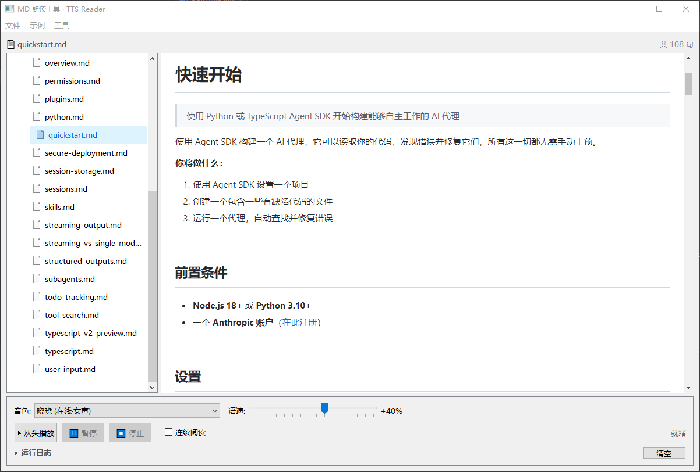
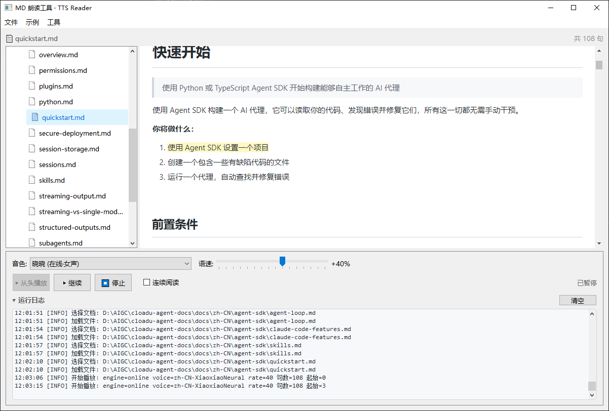

# MD 朗读工具 · TTS Reader

一个基于 **PyQt5 + QWebEngine** 的 Markdown 朗读工具：加载 Markdown 文档后，在标准 markdown 渲染预览中点击句子即可定位朗读，支持**在线 edge-tts** 与**本机系统语音**双引擎，面向 Windows / macOS。

## ✨ 特性

- **双 TTS 引擎**

  - 在线：edge-tts（晓晓，音质高，需联网，带**预合成**，句间几乎无停顿）

  - 本地：本机系统中文语音（离线、零延迟；Windows 用 SAPI，macOS 用 AVSpeechSynthesizer）

- **标准 Markdown / MDX 渲染**：GitHub 风格主题、代码高亮（pygments）、图片自适应不跳动

- **点击定位朗读**：点击任意句子即可从该句开始朗读，当前句高亮

- **目录树浏览**：左侧以树形展示整个目录（含子目录）下的 `.md` / `.mdx` 文档，同名文件按目录区分

- **连续阅读**：按目录顺序自动朗读下一篇，读完循环

- **语速/音色实时调整**（本地模式下一句生效）

- **TTS 磁盘缓存**：在线合成结果缓存到本地，循环阅读零重复合成

- **运行日志面板**：底部可折叠实时日志，便于排查问题

- **平台感知打包**：`build.ps1`（Windows） / `build.sh`（macOS）

## 🖼 截图

主界面与目录树浏览：



底部运行日志面板：



## 📦 安装

需要 **Python 3.10+**。推荐使用 conda 环境。

```bash
# 1. 创建环境并安装依赖（任选其一）
conda create -n md-tts-reader python=3.12 -y
conda activate md-tts-reader
pip install -r requirements.txt

# 或直接安装：
#   pip install PyQt5 PyQtWebEngine edge-tts pygame markdown pygments
```

> macOS 本地语音额外需要：`pip install pyobjc-framework-AVFoundation`

## 🚀 使用

```bash
python main_window.py
```

或双击打包后的可执行文件（见下文「打包」）。

1. 菜单 **文件 → 打开 MD/MDX 目录**，选择存放 Markdown 文档的文件夹；
2. 左侧树形列表展开目录，点击任意文档即可渲染预览；
3. 点击预览中的句子，从该句开始朗读；
4. 底部控制条可切换在线/本地音色、调整语速，勾选「连续阅读」自动读下一篇。

## 🛠 打包成可执行程序

### Windows（`build.ps1`）

```powershell
powershell -ExecutionPolicy Bypass -File .\build.ps1
```

- 自动定位 conda 环境 `md-tts-reader`（找不到则回退 PATH 中的 python）；

- 输出 `dist\MDReader\MDReader.exe`；

- 可选参数：`-Run`（打包后保持运行）/ `-NoVerify`（只打包不验证）。

### macOS（`build.sh`）

```bash
./build.sh
```

输出 `dist/MDReader.app`。可选 `--run` / `--no-verify`。

## 🗂 项目结构

```
main_window.py      主窗口：目录树 + 渲染预览 + 播放控制 + 日志面板编排
md_parser.py        Markdown/MDX 解析与句子切分（朗读序列的权威来源）
markdown_render.py  标准 Markdown 渲染（QWebEngine / pygments）
markdown_view.py    Markdown 渲染预览视图（QWebEngineView，点击定位/高亮）
log_panel.py        运行日志 -> GUI 桥接 + 可折叠日志面板
tts_engine.py       TTS 引擎：在线 edge-tts + 本地 SAPI / AVSpeech 双实现
tts_cache.py        在线合成音色的磁盘缓存
app_logger.py       文件日志（RotatingFileHandler）+ 异常兜底
build.ps1           Windows 编译脚本（含 conda 依赖 DLL 注入）
build.sh            macOS 编译脚本
```

## 📝 日志与缓存位置

| 平台      | 运行日志                              | TTS 缓存                           |
| ------- | --------------------------------- | -------------------------------- |
| Windows | `%LOCALAPPDATA%\MDReader\app.log` | `%LOCALAPPDATA%\MDReader\tts\`   |
| macOS   | `~/Library/Logs/MDReader/app.log` | `~/Library/Caches/MDReader/tts/` |

菜单 **工具 → 清理 TTS 缓存…** 可手动清理缓存。

## 🤝 贡献

欢迎提交 Issue 与 Pull Request。请确保改动后用 `python -m py_compile main_window.py` 通过语法检查，并按需重新打包验证。

## 📄 License

[MIT](./LICENSE) © 2026
